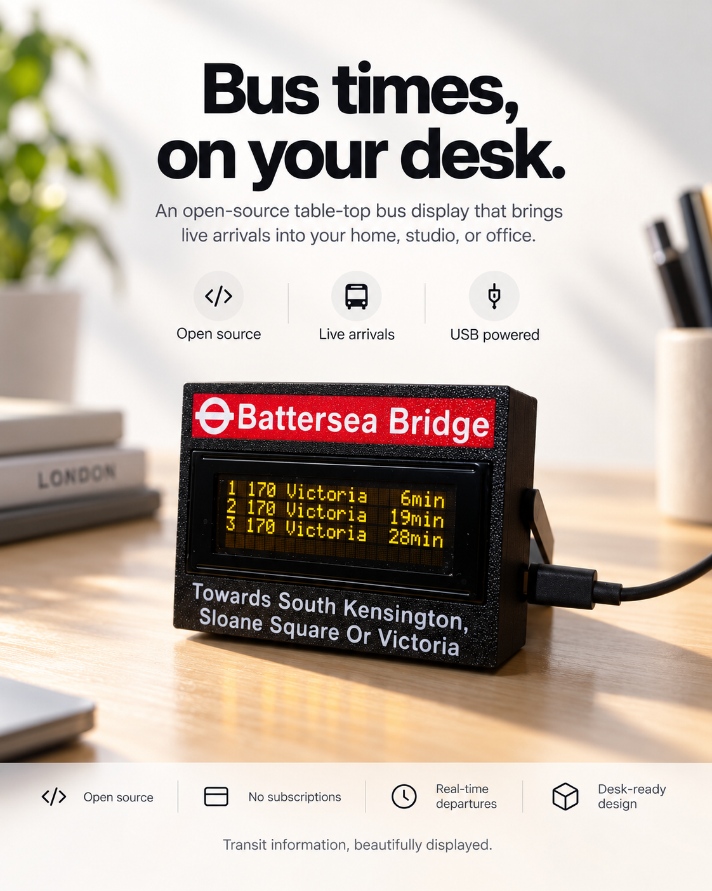
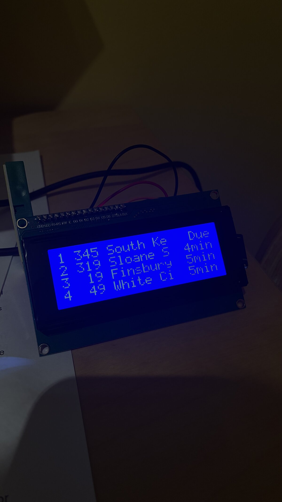
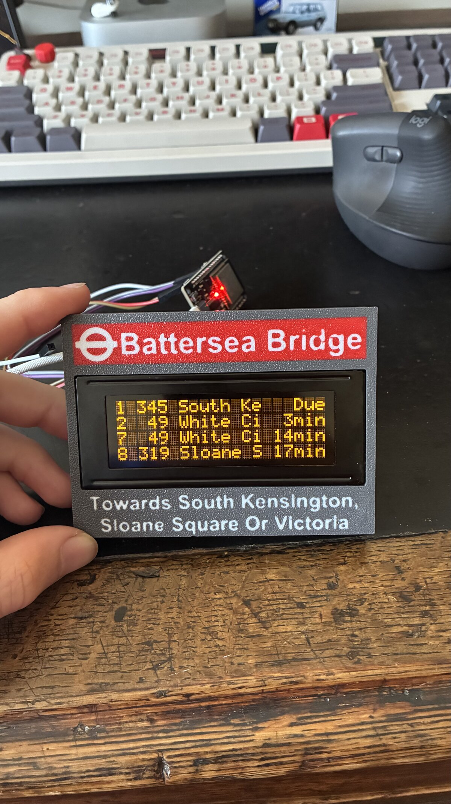
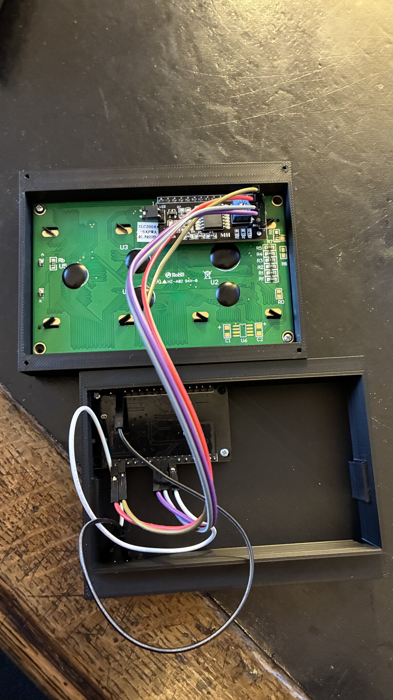
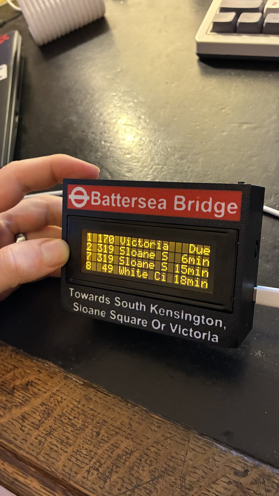

# Bus Stop Screen

**Live bus arrivals on your desk.** This is a small, open-source, 3D-printed countdown display, like the ones at London bus stops. An ESP32 fetches live arrivals over Wi-Fi and shows them on an orange 20×4 character LCD.



- **Live arrivals** from the free [Transport for London (TfL) API](https://api-portal.tfl.gov.uk/). You don't need an API key or a subscription.
- **One button** cycles through the screens: all buses, one route at a time, then a clock with a "buses today" counter.
- **USB-C powered.** Plug it into any phone charger.
- **Works anywhere.** London is the default, but you can point it at any transit API that returns live arrivals.

---

## Contents

- [What it shows](#what-it-shows)
- [Parts list](#parts-list)
- [Build journey](#build-journey)
- [Repository layout](#repository-layout)
- [3D printing the case](#3d-printing-the-case)
- [Wiring](#wiring)
- [Flashing the firmware](#flashing-the-firmware)
- [Assembly](#assembly)
- [Using it outside London](#using-it-outside-london)
- [Troubleshooting](#troubleshooting)
- [License](#license)

---

## What it shows

Each row is laid out like a real bus-stop countdown:

```
1 170 Victoria  6min
2 170 Victoria 19min
3  44 Victoria 23min
4 170 Victoria 28min
```

| Screen | How you get there | What it shows |
|---|---|---|
| **All buses** | Default (it returns here 30 s after the last button press) | The next arrivals from every route at the stop. The top two rows stay fixed; the bottom two rows scroll through arrivals 3–10 every 10 s. |
| **Single route** | Press the button | Arrivals for one route only. Keep pressing to step through each route that serves the stop. |
| **Stats** | Press past the last route | The current time and how many buses have left the stop today. The count resets at midnight. |

Arrivals refresh every 20 seconds.

---

## Parts list

| Qty | Part | Notes |
|---|---|---|
| 1 | **20×4 character LCD, orange/amber, with I²C backpack** | The one I used: [AliExpress 32910216005](https://www.aliexpress.com/item/32910216005.html). Any HD44780-compatible 2004 LCD with a PCF8574 I²C backpack will work. Pick the orange/amber version for the bus-stop look. |
| 1 | **ESP32 dev board** | Any ESP32 with Wi-Fi, e.g. ESP32-DevKitC / ESP32-WROOM-32. A USB-C version lets you use one cable for power and programming. |
| 1 | **Momentary push button** | A regular normally-open tactile or panel button. It cycles through the screens. |
| ~6 | **Jumper wires** (female–female Dupont) | 4 for the display and 2 for the button. |
| 1 | **USB-C cable + 5 V USB power supply** | Any phone charger is fine. |
| — | **3D-printed case** | The front, back and stand files are in [`cad/`](cad/). |

The red stop-name banner and the "Towards …" text on the front are printed in colour as part of the front shell. You'll also need a few small screws to hold the LCD and the ESP32 in place.

---

## Build journey

| 1. Idea | 2. First print | 3. Internals | 4. Final |
|:---:|:---:|:---:|:---:|
|  |  |  |  |
| A quick test with parts I already had: a blue 20×4 LCD showing live TfL arrivals. | My first attempt at the front case, with the orange LCD and the colour-printed stop sign. | The LCD and its I²C backpack are screwed into the front shell, and the ESP32 sits in the back shell. | The finished screen, powered by USB-C, with the menu button on top. |

---

## Repository layout

```
.
├── cad/                       3D-printable enclosure (STEP, millimetres)
│   ├── front.step             Front shell (holds the LCD)
│   ├── back.step              Back shell (holds the ESP32)
│   └── stand.step             Desk stand
├── firmware/
│   └── BusStopScreen/
│       ├── BusStopScreen.ino  Arduino sketch
│       └── secrets.example.h  Wi-Fi credentials template
├── images/
│   ├── poster.png
│   └── build-*.jpeg           Build photos
├── LICENSE
└── README.md
```

---

## 3D printing the case

The case has three parts. The files are in STEP format, so you can import them into any slicer (PrusaSlicer, OrcaSlicer, Bambu Studio, Cura 5+) or edit them in CAD.

| Part | File | Approx. size |
|---|---|---|
| Front | [`cad/front.step`](cad/front.step) | 104 × 77 × 18.5 mm |
| Back | [`cad/back.step`](cad/back.step) | 104 × 77 × 22 mm |
| Stand | [`cad/stand.step`](cad/stand.step) | 110 × 49 × 13 mm |

When assembled, the case is about 104 × 77 × 40 mm, so it fits on any printer bed.

**Suggested settings** (nothing in these parts is critical):

- **Material:** PLA or PETG. Matte black looks the most like a real bus-stop sign.
- **Colours:** The front shell has the stop sign built in: a red banner with white text, and white "Towards …" text below the display. Use a multi-material printer (e.g. AMS/MMU) or a manual filament change at the right layer. To show your own stop, import `front.step` into a CAD tool, remove the existing lettering and add your own. STEP files keep the shape but not editable text.
- **Layer height:** 0.2 mm
- **Walls:** 3 perimeters
- **Infill:** 15–20 %
- **Orientation:** Print the front shell face-down on the bed. This gives the visible face a clean, flat finish (a textured PEI sheet gives the speckled look in the photo). Print the back shell with its open side up and the stand flat on its largest face.
- **Supports:** Only enable them if your slicer flags overhangs, e.g. around the USB port cut-out.

Before you print the whole case, it's worth printing a test of the LCD window and checking that your display fits. 2004 LCD modules vary by a fraction of a millimetre between sellers.

---

## Wiring

| From | To (ESP32) | Notes |
|---|---|---|
| LCD **GND** | **GND** | |
| LCD **VCC** | **5V / VIN** | The LCD backlight needs 5 V |
| LCD **SDA** | **GPIO 25** | I²C data |
| LCD **SCL** | **GPIO 26** | I²C clock |
| Button leg 1 | **GPIO 33** | Uses the internal pull-up, so you don't need a resistor |
| Button leg 2 | **GND** | |

```
            ESP32
         ┌──────────┐
 LCD VCC ─┤ 5V       │
 LCD GND ─┤ GND ─────┼─── Button ───┐
 LCD SDA ─┤ GPIO 25  │              │
 LCD SCL ─┤ GPIO 26  │              │
          │ GPIO 33 ─┼──────────────┘
          └────┬─────┘
             USB-C (power)
```

You can use other pins if you like. Change `sdaPin`, `sclPin` and `buttonPin` at the top of the sketch to match.

---

## Flashing the firmware

### 1. Set up the Arduino IDE

1. Install the [Arduino IDE](https://www.arduino.cc/en/software).
2. Add ESP32 support: **Boards Manager** → search **"esp32"** → install **esp32 by Espressif Systems**.
3. Install these libraries from the **Library Manager**:
   - **LiquidCrystal I2C** by Frank de Brabander
   - **ArduinoJson** by Benoit Blanchon (v7 tested; v6 also works)

### 2. Add your Wi-Fi details

```bash
cd firmware/BusStopScreen
cp secrets.example.h secrets.h
```

Edit `secrets.h`:

```cpp
#define WIFI_SSID     "your-wifi-name"
#define WIFI_PASSWORD "your-wifi-password"
```

`secrets.h` is in `.gitignore`, so your password won't end up in a commit. The ESP32 only supports **2.4 GHz** Wi-Fi.

### 3. Choose your bus stop

At the top of `BusStopScreen.ino`:

```cpp
const String stopId = "490003683N"; // TfL NaPTAN stop ID
```

To find your stop's ID, use either of these:

- Search for your stop on [tfl.gov.uk/travel-information/stations-stops-and-piers](https://tfl.gov.uk/travel-information/stations-stops-and-piers/) and open it. The ID is the code that starts with `490…` in the page URL, e.g. `tfl.gov.uk/bus/stop/`**`490003683N`**`/battersea-bridge`. Make sure you pick the stop for the direction you travel in, because each side of the road has its own ID.
- Or search the API directly:
  `https://api.tfl.gov.uk/StopPoint/Search/battersea%20bridge?modes=bus`.
  Then open `https://api.tfl.gov.uk/StopPoint/<id>` to see the individual stops (each direction has its own ID).

Check the ID by opening `https://api.tfl.gov.uk/StopPoint/<your-id>/Arrivals` in a browser. You should see a JSON list of buses.

### 4. Upload

1. Open `firmware/BusStopScreen/BusStopScreen.ino` in the Arduino IDE.
2. Select **Tools → Board → ESP32 Dev Module** (or your specific board) and the correct port.
3. Click **Upload**.

When it boots, the display shows "Connecting WiFi…" and then the arrivals. To see debug output, open the Serial Monitor at **115200 baud**.

---

## Assembly

1. **Flash and test first.** Wire everything up on the bench and check that arrivals appear before you put anything in the case.
2. **Fit the LCD** into the front shell, display facing out through the window, and screw it in through its corner mounting holes. The I²C backpack faces the inside of the case.
3. **Screw the ESP32** into the back shell, with its USB-C port lined up with the cut-out in the case.
4. **Mount the button** in the top of the case, then connect its two wires to GPIO 33 and GND.
5. **Route the jumper wires** so nothing is pinched, then press the front and back shells together.
6. **Attach the stand** to the back so the display leans back at a comfortable viewing angle.
7. Plug in the USB-C cable.

---

## Using it outside London

The firmware uses the TfL Arrivals endpoint, but everything that's specific to TfL is in one function, `fetchData()`. To use another transit provider, there are two things to change:

1. **The URL.** Replace

   ```cpp
   String url = "https://api.tfl.gov.uk/StopPoint/" + stopId + "/Arrivals";
   ```

   with your provider's live-arrivals endpoint. Many providers need an API key, which you can add to `secrets.h`.

2. **The JSON fields.** The display code reads these fields from each arrival:

   | Field | Meaning |
   |---|---|
   | `lineId` / `lineName` | Route number, e.g. `170` |
   | `destinationName` | Where the bus is going |
   | `timeToStation` | Seconds until arrival |
   | `vehicleId` | Unique vehicle ID (used for the "buses today" counter) |

   If your provider uses different names, the simplest fix is to map its response onto these fields in `fetchData()`. Then the rest of the sketch works without changes.

Also update the `timezone` string (a [POSIX TZ string](https://github.com/nayarsystems/posix_tz_db/blob/master/zones.csv)) so the clock and the midnight counter reset use your local time.

Some APIs that work well with this approach: [Transport for NSW](https://opendata.transport.nsw.gov.au/), [MBTA (Boston)](https://www.mbta.com/developers/v3-api), [Entur (Norway)](https://developer.entur.org/), [Transitland](https://www.transit.land/) and many GTFS-Realtime feeds (these need a little more parsing).

---

## Troubleshooting

| Symptom | Fix |
|---|---|
| Backlight on but no text | Turn the contrast potentiometer on the back of the I²C backpack. |
| Nothing on the display | Check the SDA/SCL wiring. Your backpack might use I²C address `0x3F` instead of `0x27`; change it in `LiquidCrystal_I2C lcd(0x27, 20, 4);`. |
| Stuck on "Connecting WiFi" | Check `secrets.h`, and make sure your network is 2.4 GHz. |
| `HTTP Error: …` on screen | Check the stop ID in a browser (see above). Codes below 0 usually mean the network is down. |
| Blank rows | The stop has fewer upcoming buses than there are rows. This is normal late at night. |
| Clock is wrong | Set `timezone` for your region. |

---

## License

[MIT](LICENSE). Build one, remix the case, port it to your city. If you do, I'd love to see it.

Powered by TfL Open Data. Contains OS data © Crown copyright and database rights 2016 and Geomni UK Map data © and database rights 2019.
